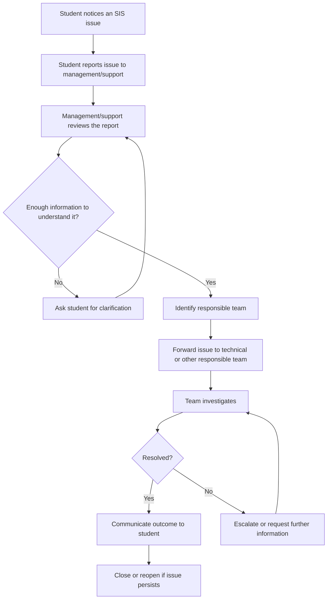
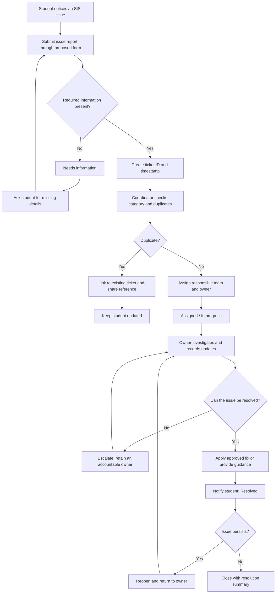

# Task 1 — Improving the Student Information System (SIS) Issue-Reporting Workflow

**Prepared:** 24 October 2026  
**Submission status:** Proposed workflow design and synthetic desk-tests  
**Scope:** Student reporting of a problem in ICFAI's Student Information System (SIS)  
**Data handling:** No live student records, credentials, marks, fee information, or private messages used

## Executive summary

This investigation examines how a student SIS problem can be reported, reviewed, passed to the responsible team, and resolved. The starting point is the broad process description provided for this project: a student reports a problem to management, management reviews it, and the issue is sent to the relevant team for investigation or repair.

The proposed improvement is a simple ticket-based workflow with a structured report form, clear status labels, a coordinator responsible for intake and updates, an assigned owner for investigation, duplicate linking, approval boundaries, and fallback handling when submission fails. Five synthetic cases were desk-tested against the proposed rules.

An illustrative time calculation assumes 10 reports per month, 12 minutes of current report-handling time per report, and 9 minutes under the proposed process after including extra review/support. This gives an illustrative net saving of 3 minutes per report, or 30 minutes per month. These are assumptions, not measured ICFAI results. Actual report volume, internal procedures, and time savings remain unverified.

## 1. Scope and method

### 1.1 Workflow selected

The selected workflow is **a student reporting a problem in ICFAI SIS**. It is suitable for a small process-improvement investigation because it has a clear starting point (a student notices a problem), handoffs (student to management/support and then to a responsible team), and an outcome (the issue is resolved or a next action is communicated).

### 1.2 Method

1. Record the broad current-state description provided for this investigation.
2. Map the likely steps and handoffs, marking details that have not been independently verified.
3. Identify plausible sources of delay or repeated work.
4. Design a proposed workflow with statuses, ownership, routing, approval boundaries, and fallback steps.
5. Desk-test the design against five synthetic cases.
6. Calculate an illustrative net time-saving scenario, including additional review/support time.
7. Record assumptions, limitations, contribution, and AI use.

No staff interview, live SIS test, internal ticket-log review, or direct observation was conducted. Therefore, the current-state map is a working model for investigation, not a verified description of every internal ICFAI procedure.

## 2. Current-state workflow map

The diagram expresses the broad process described for this project and adds plausible steps to make handoffs and exceptions visible. Clarification, escalation, closure, and reopening are included as process possibilities to investigate; they are not asserted as verified live SIS features.

### 2.1 Current-state steps and handoffs

| Step | Actor / handoff | What happens | Evidence status |
|---|---|---|---|
| 1 | Student | Notices a problem in SIS | Expected starting point for this workflow |
| 2 | Student → management/support | Reports the issue | User-provided description |
| 3 | Management/support | Reviews the report and identifies what is needed | Broadly described; detailed procedure unverified |
| 4 | Management/support → responsible team | Passes the issue to the relevant team | User-provided description at a high level |
| 5 | Responsible team | Investigates and attempts a fix or other resolution | Reasonable process step; internal details unverified |
| 6 | Responsible team / management → student | Communicates the outcome or next action | Proposed point to verify; exact current practice unknown |

### 2.2 Problem statement

If issue reports do not contain enough detail, do not reach the correct team promptly, or lack a clear owner and status update, students and staff may need repeated clarification and follow-up. These are potential failure points to investigate, not confirmed rates of failure at ICFAI.

### 2.3 Questions for future verification

- What channel do students currently use to report SIS issues?
- Is a ticket/reference number generated?
- Who is responsible for initial triage and routing?
- What information is normally required to investigate a report?
- How are duplicate reports and urgent or sensitive issues handled?
- How are students informed about progress and closure?
- Are there approved response-time targets or escalation rules?
- How many reports arrive in a typical week or month, and how long does handling take?

## 3. Proposed improved workflow

### 3.1 Proposed process

### 3.2 Proposed intake form

| Field | Requirement / purpose |
|---|---|
| Issue category and SIS page/feature | Required for routing |
| Short title and description | Required to understand the issue |
| Expected result and actual result/error | Required where relevant |
| Approximate date/time | Required where known |
| Steps to reproduce | Required where possible |
| Impact and urgency | Helps prioritisation |
| Screenshot | Optional; only if it contains no sensitive information |
| Approved contact method | Used for follow-up |

The form must not request passwords, one-time passcodes, or full payment details. Students should avoid submitting other students' information and should remove student IDs, marks, fee details, and other private information from screenshots unless an authorised process specifically requires it. A prototype should use synthetic examples and must not connect to the live SIS.

### 3.3 Ticket statuses

| Status | Meaning | Responsibility / next action |
|---|---|---|
| New | Report received, not yet checked | Coordinator reviews |
| Needs information | Details are missing | Coordinator asks targeted questions |
| Assigned | Responsible team and owner identified | Assigned owner starts investigation |
| In progress | Investigation or approved work is underway | Owner records progress |
| Waiting | Blocked by information, another team, or an approved external action | Owner records blocker and next step |
| Resolved | Fix, workaround, or guidance provided | Notify student |
| Reopened | Issue persists or returns | Return to responsible owner |
| Closed | Outcome and resolution summary recorded | Retain according to applicable policy |

Every status change should record a timestamp, the role making the change, and a short reason. Student-facing updates should not reveal sensitive internal notes.

### 3.4 Ownership and approval boundaries

- **Coordinator:** accountable for intake, triage, assignment, and student updates.
- **Assigned team owner:** responsible for investigation, progress notes, and resolution or escalation.
- **Authorised academic/records/finance staff:** approve and make protected record changes only within their actual permissions.
- **Technical team:** investigates technical defects and follows the institution's authorised process for production changes.
- **Escalation:** the original coordinator or a designated owner tracks the ticket until the next owner accepts it.

The coordinator may classify and route a report but does not gain permission to change academic, financial, or other protected records. A ticket is not itself authorisation to make a change. If no suitable team is clear, the coordinator retains ownership while seeking an authorised routing decision.

### 3.5 Duplicate handling

Check whether an open ticket describes the same issue, page/feature, and approximate time period. If it is a likely duplicate, link it to the existing ticket, tell the student the existing reference, and preserve the additional report for impact counting. If the new report indicates a distinct failure, keep a separate ticket and link the two as related.

### 3.6 Fallback and exceptions

- **Form unavailable:** use an existing institution-approved support channel. Record a fallback report in the approved manual log when possible.
- **Ticket creation fails:** do not show a false success message; ask the student to retry or use the approved fallback channel.
- **No clear category/team:** coordinator retains ownership and seeks the correct route.
- **Owner unavailable:** assign a backup or escalate; do not leave the issue silently unowned.
- **Fix fails:** reopen and return to the responsible owner.
- **Potential privacy/security incident:** use the authorised reporting process and restrict unnecessary access to the report.
- **No student response:** follow an approved closure rule if one exists; do not invent an official closure period.

### 3.7 How the design addresses potential issues

| Potential issue | Proposed control | Intended benefit |
|---|---|---|
| Incomplete reports | Structured form and Needs information status | Fewer avoidable clarification cycles |
| Unclear ownership | Coordinator plus assigned owner | Clear accountability |
| Repeated reports | Duplicate linking and report counts | Less duplicated investigation; better visibility of impact |
| Wrong routing | Categories and ownership until acceptance | Fewer lost/unassigned reports |
| Issue persists after a fix | Resolved and Reopened states | Clear recovery path |
| Unnecessary sensitive data | Data-minimisation rules and approval boundaries | Reduced privacy and access risk |

## 4. Synthetic test cases

These are desk-tests of the proposed design, not tests of the live SIS or an executable application.

| Test | Synthetic case | Expected result | Recovery / pass condition |
|---|---|---|---|
| TC-01 — Normal report | Fictional student provides the page, approximate time, error text, expected result, and reproduction steps. | Validate fields, create ticket ID, check duplicates, assign technical owner, and confirm receipt. | Owner records investigation and approved resolution. Ticket has reference, owner, history, and student-facing update. |
| TC-02 — Missing information | Report says only “SIS is not working” with no page or observed behaviour. | Set `Needs information`; coordinator asks targeted questions and retains ownership. | Resume triage when details arrive. Do not silently discard or mark resolved. |
| TC-03 — Duplicate | New fictional report matches open synthetic ticket `SIS-DEMO-014`. | Link to existing ticket and preserve the new report for impact counting. | Give the student the existing reference; separate it if evidence shows a distinct failure. |
| TC-04 — Unauthorised request | User asks support to change another student's marks without authorisation. | Do not change the record. Route only through the authorised academic-record process if appropriate. | Respect access boundaries, record the decision, and use authorised security/privacy escalation if needed. |
| TC-05 — Failed step | Proposed form fails to create a ticket and generates no reference. | Do not claim successful submission. Explain the failure and provide an approved fallback. | If a fallback report arrives, log it with timestamp and check for accidental duplicates after retries. |

### 4.1 Desk-test results

| Test | Design review result | Reason |
|---|---|---|
| TC-01 | Pass by design | Complete information can proceed through assignment and resolution |
| TC-02 | Pass by design | Missing details trigger follow-up while ownership remains clear |
| TC-03 | Pass by design | Duplicate is linked, not silently discarded |
| TC-04 | Pass by design | Protected changes require authorisation |
| TC-05 | Pass by design | Failed submission does not produce false confirmation and has a fallback |

“Pass by design” means the proposed rules describe the expected behaviour. It does not mean code was executed or that the live SIS was tested.

## 5. Problem scale and net time-saving estimate

### 5.1 Illustrative inputs

The actual number of SIS reports and handling times are unknown. To demonstrate the calculation, the following inputs are assumptions and should be replaced with authorised measurements if available.

| Measure | Illustrative value | Classification |
|---|---:|---|
| Reports per month | 10 | Assumption |
| Current report-handling time per report | 12 minutes | Assumption |
| Proposed coordinator time per report | 7 minutes | Assumption |
| Additional review/support time per report | 2 minutes | Assumption |

### 5.2 Calculation

- Current monthly handling = 10 reports × 12 minutes = **120 minutes**.
- Proposed monthly handling, including review/support = 10 × (7 + 2) = **90 minutes**.
- Net monthly saving = 120 − 90 = **30 minutes**.
- Net saving per report = 30 ÷ 10 = **3 minutes**.
- Reduction in report-handling time = 30 ÷ 120 × 100 = **25%**.
- If volume and times stayed constant, annual saving = 30 × 12 = **360 minutes (6 hours)**.

**Interpretation:** In this illustrative scenario, the proposed workflow saves 3 minutes per report after including the extra review/support time. This is a demonstration of the method, not a measured result for ICFAI. The estimate covers report handling only; it does not assume that structured intake reduces the technical effort required to fix the underlying software defect.

### 5.3 Sensitivity check

At 10 reports/month and 12 minutes of current handling per report:

| Proposed coordinator + review/support time per report | Proposed monthly time | Net monthly saving |
|---:|---:|---:|
| 8 minutes | 80 minutes | 40 minutes |
| 9 minutes | 90 minutes | 30 minutes |
| 10 minutes | 100 minutes | 20 minutes |
| 12 minutes | 120 minutes | 0 minutes |
| 13 minutes | 130 minutes | −10 minutes |

The design only saves time if the total proposed handling effort, including review/support, is lower than the current effort.

### 5.4 Validation plan

If authorised aggregate data becomes available:
1. Count reports received over a defined period.
2. Time handling effort including clarification, routing, and follow-up.
3. Count reports needing clarification, rerouting, and duplicate handling.
4. Time the same scenarios through a prototype if one is built.
5. Include all extra review/support effort.
6. Compare equivalent periods and state the sample size and limitations.

Suggested aggregate columns: `period`, `report_count`, `current_minutes_total`, `proposed_minutes_total`, `extra_review_minutes`, `clarification_count`, `reroute_count`, and `duplicate_count`. Do not copy student identifiers or private report content.

## 6. Dated evidence and assumptions log

| Date | Evidence item | Classification | What it supports | Limitation |
|---|---|---|---|---|
| 24 Oct 2026 | Broad description: student reports SIS issue to management; management reviews and passes it to a responsible team | User-provided context | Starting point for current-state map | Does not verify the full internal procedure |
| 24 Oct 2026 | Current-state diagram and handoff table | Working process model | Makes steps and unknowns explicit | Some exception steps are plausible items to verify, not observed facts |
| 24 Oct 2026 | Structured ticket workflow | Proposed design | Specifies intended statuses, ownership, routing, and recovery | Not implemented in live SIS |
| 24 Oct 2026 | TC-01 to TC-05 | Synthetic desk-test | Checks proposed responses to five required cases | No live system or executable prototype tested |
| 24 Oct 2026 | 10 reports/month; 12 current minutes; 7 proposed coordinator minutes; 2 review/support minutes | Explicit assumptions | Demonstrates net time calculation | Not measured ICFAI data |
| 24 Oct 2026 | Privacy, approval, and fallback rules | Design safeguards | Defines boundaries for a safe prototype | Must be reconciled with actual institutional policy before deployment |

## 7. Sources and access record

This assessment is based on the workflow description provided for the project, the proposed design, and synthetic scenario tests. No external source was used to verify ICFAI's internal SIS handling process. No internal procedure, ticket data, staff interview, or live SIS observation was available for this report.

**Source/access record as of 24 Oct 2026**
- User-provided workflow description — available in the project conversation on 24 Oct 2026; not a public URL.
- Synthetic test cases and illustrative calculation — created for this assessment on 24 Oct 2026; not external evidence.

Before making claims about the institution's actual process, verify the appropriate official ICFAI/IFHE SIS support channel and applicable institutional policy through an authorised source, and record the exact page/document URL and date accessed. Do not cite a generic homepage as proof of a specific internal process.

## 8. Personal contribution and AI-use record

### Personal contribution

The workflow selected for this investigation was the student reporting an SIS problem. The broad starting process was described for the project. The proposed form, ticket statuses, routing and approval boundaries, fallback rules, synthetic test cases, and time-saving calculation were developed as a process-improvement design. No faculty member or institutional staff member was consulted for this assessment, and no claim of institutional validation is made.

### AI use

AI assistance was used to organise the workflow map, structure the proposed process, draft synthetic test cases, and check the arithmetic and clarity of the time-saving estimate. The workflow details and timing inputs are explicitly distinguished from verified facts. The proposed process has not been implemented or validated in the live SIS. The author should review and edit this report to ensure it accurately reflects their own work and the institution's assignment rules.

## 9. Limitations

- The internal ICFAI SIS process was not independently verified.
- No staff interviews, live system tests, or ticket-log analysis were conducted.
- The five tests are synthetic desk-tests, not executable test results.
- The report volume and all time inputs are assumptions.
- The proposal does not specify an official SLA, closure period, or actual team names because these were not verified.
- Any real implementation would require institutional approval, authorised ownership, privacy review, and alignment with existing support and change-management policies.

## 10. Conclusion

A structured issue-reporting workflow could make SIS problems easier to classify, assign, track, and recover when a report is incomplete or a submission fails. The design gives each report a reference, keeps ownership clear, preserves duplicate reports for impact counting, respects approval boundaries, and provides a fallback path. The five synthetic desk-tests indicate that the proposed rules cover the required scenarios. The illustrative calculation shows a possible net saving of 3 minutes per report after including review/support effort, but actual impact must be measured before it can be reported as an institutional result.
