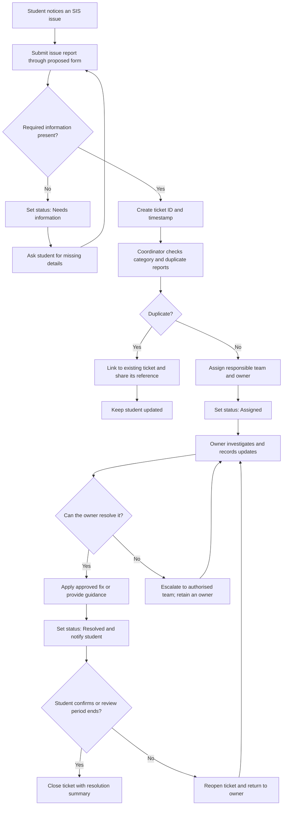

# Task 1 — Step 2: Proposed Improved SIS Issue-Reporting Workflow

**Prepared:** 24 October 2026  
**Status:** Proposed design for assessment; not implemented in ICFAI SIS  
**Data:** Synthetic examples only; no student records or private messages used

## 1. Objective

Make it easier for a student to report a problem with the ICFAI Student Information System (SIS), help the responsible team understand and route the issue, and keep the student informed until the issue is resolved. The design aims to reduce repeated explanations, missing details, duplicate work, and reports that have no clear owner.

The current-state description in Step 1 is based on the broad workflow described for this investigation. Internal ICFAI procedures have not been independently verified. The process below is a proposed improvement, not a claim about the live system.

## 2. Proposed workflow

## 3. Intake form and required information

The proposed form should ask for only the information needed to investigate the issue.

| Field | Requirement | Purpose |
|---|---|---|
| Issue category | Required | Helps route the report |
| SIS page or feature | Required | Identifies where the issue occurs |
| Short title | Required | Makes the issue easy to scan |
| Description | Required | Explains what happened |
| Expected result | Required where relevant | Clarifies what the student expected |
| Actual result / error text | Required where relevant | Records what the system did |
| Approximate date and time | Required where known | Helps correlate the issue with logs |
| Steps to reproduce | Required where possible | Helps the owner test the problem |
| Impact / urgency | Required | Helps prioritise work |
| Screenshot | Optional | Useful if it is safe and contains no sensitive information |
| Contact method | Use an approved channel | Allows follow-up |

**Privacy rule:** Never request passwords, one-time passcodes, full payment details, or another student's information. Students should remove student IDs, marks, fee details, contact details, and other private information from screenshots unless an authorised process specifically requires it. The prototype should use synthetic examples and should not connect to the live SIS.

## 4. Ticket statuses

| Status | Meaning | Next action / responsibility |
|---|---|---|
| New | Report received but not yet checked | Coordinator reviews it |
| Needs information | Required details are missing | Coordinator asks the student for specific details |
| Assigned | A responsible team and owner have been identified | Assigned owner begins investigation |
| In progress | Investigation or approved work is underway | Owner records progress and next step |
| Waiting | Blocked by information, another team, or an approved external action | Owner explains the blocker and follow-up plan |
| Resolved | A fix or workaround has been provided | Notify student and request confirmation where practical |
| Reopened | The reported issue persists or returns | Return it to the responsible owner |
| Closed | Resolution and outcome have been recorded | Retain the ticket according to the applicable policy |

Every status change should record a timestamp, the role making the change, and a short reason. Avoid displaying internal notes or sensitive technical details to the student.

## 5. Ownership, routing, and approval boundaries

| Report type | Initial routing | Decision boundary |
|---|---|---|
| Page not loading, broken link, error message, or system malfunction | SIS technical team | Technical team investigates; production changes follow the institution's authorised release process |
| Login or access problem | Authorised account/support team | Identity checks must follow approved procedures; never ask for passwords or OTPs |
| Incorrect student record, marks, attendance, or fee information | Authorised records / academic / finance team, as applicable | Only staff with the appropriate authority may approve and make record changes |
| Unclear category or no team identified | Coordinator retains ownership and seeks the correct route | A ticket must not be left unassigned simply because routing is uncertain |
| Similar report already exists | Link to the existing ticket | Do not silently discard the new report; record that it is a duplicate and communicate the reference |

**Accountability:** A support/management coordinator is accountable for intake, triage, assignment, and student updates. Once assigned, a named owner in the responsible team is accountable for investigation and progress. If the ticket is escalated, the original coordinator or explicitly designated owner tracks it until another owner accepts it.

The coordinator may classify and route reports but must not approve academic, financial, account, or other protected record changes unless separately authorised. A technical owner must not bypass required approvals to deploy a fix. The workflow does not grant new permissions.

## 6. Duplicate handling

Before assigning a report, the coordinator checks whether an open ticket describes the same issue, page or feature, and approximate time period.

- If it is a likely duplicate, link the new report to the existing ticket and retain the original ticket as the main investigation.
- Tell the student the reference number and how they will receive updates.
- Keep a count of linked reports so repeated reports can indicate wider impact.
- If the new report includes materially different evidence or a distinct failure, keep it separate and link the related tickets.

A duplicate report should not be treated as resolved merely because another ticket exists; the student should still receive a clear reference and update path.

## 7. Prioritisation and student updates

Use impact and urgency to help the coordinator prioritise. For example, a problem preventing many students from accessing a required SIS function should be reviewed ahead of a cosmetic issue affecting one page. These are proposed prioritisation principles, not official ICFAI service-level commitments.

At minimum, send a confirmation when a ticket is created, an update when it is assigned or blocked, and a resolution message explaining what was fixed or what workaround is available. If an issue is still open, the owner should give the student a next-update point rather than leaving the report silent. Do not promise a fixed resolution time until an authorised service target is known.

## 8. Failure and fallback plan

- **Form unavailable:** Direct students to an existing, institution-approved support channel. A coordinator records the report in the approved manual log when service returns.
- **Ticket creation fails:** Show a clear failure message if possible; do not claim the report was received. Ask the student to retry or use the approved fallback channel.
- **No suitable category or team:** Keep the ticket with the coordinator, record the routing uncertainty, and seek an authorised decision.
- **Assigned owner is unavailable:** The coordinator assigns a backup or escalates; the ticket remains visible as unassigned/blocked until ownership is accepted.
- **Fix does not work:** Reopen the ticket, attach safe reproduction details, and return it to the owner.
- **Potential privacy or security incident:** Stop normal handling and route it through the institution's authorised security/privacy reporting process. Do not expose the report broadly or include secrets in comments.
- **No response from student:** Keep the ticket in an appropriate waiting status and follow a documented closure rule, if one is approved. Do not invent an official closure period for this assessment.

## 9. Minimal prototype data model

A prototype can represent the workflow without connecting to SIS:

- `ticket_id` — synthetic unique reference
- `created_at` — report timestamp
- `category`, `page_or_feature`, `title`, `description`
- `expected_result`, `actual_result`, `reproduction_steps`
- `impact`, `urgency`
- `status`, `assigned_team`, `owner_role`
- `duplicate_of` — optional ticket reference
- `status_history` — timestamp, role, status, reason
- `resolution_summary`, `closed_at` — when applicable

Use synthetic ticket references and fictional examples. Do not store live student identifiers, credentials, marks, fee information, or private messages in the prototype.

## 10. How the proposed design addresses the problem

| Potential problem in the described workflow | Proposed control | Intended benefit |
|---|---|---|
| Reports arrive without enough detail | Structured intake form and a “Needs information” status | Fewer clarification cycles |
| Student does not know who is handling the issue | Named owner / responsible team and status updates | Clear accountability |
| Similar reports create repeated work | Duplicate linking while preserving report counts | Less duplicated investigation and better visibility of scope |
| Reports are sent to the wrong team | Category-based routing and coordinator ownership until accepted | Fewer lost or unassigned reports |
| A fix is assumed complete without checking | Resolved, Closed, and Reopened statuses | Easier recovery when the issue persists |
| Sensitive information may be shared unnecessarily | Data-minimisation rules and authorised approval boundaries | Lower privacy and access risk |

## 11. Evidence and assumptions to record

This is a design proposal, so its benefits have not yet been measured. Record the following as assumptions until tested:

- A structured form will improve the completeness of reports.
- A ticket reference and visible status will reduce repeated “any update?” enquiries.
- Duplicate linking will reduce repeated investigation.
- Routing categories will help the coordinator identify the correct team.
- The institution has, or can designate, authorised support and technical roles; their actual names and procedures must be verified before any real deployment.

For the next step, test the design against five **synthetic** cases: a normal report, missing information, a duplicate, an unauthorised request, and a failed step. Record the expected outcome and recovery for each.
