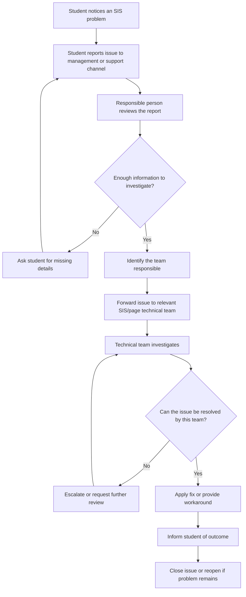

# Task 1 — SIS Issue Reporting and Resolution Workflow
## Step 1: Scope and current-state process map

**Prepared:** 24 October 2026  
**Investigation type:** Independent student process-improvement investigation  
**Workflow selected:** Reporting and resolving student-facing issues with the ICFAI Student Information System (SIS)

## 1. Purpose and scope

I selected the student-facing SIS issue-reporting and resolution workflow because SIS is a system students use and a problem with a page or function may require the issue to be reported, reviewed, routed, and resolved.

The investigation focuses on the path from a student noticing a problem to receiving an update about its resolution. It does not attempt to inspect, access, or change the live SIS, and it does not claim access to internal management or developer procedures.

**In scope**
- A student identifies a problem in SIS.
- The student reports the problem through a suitable support or management channel.
- The report is reviewed and passed to the appropriate responsible person or technical team.
- The technical team investigates and, where appropriate, fixes the issue.
- The student is informed of the outcome or the need for more information.

**Out of scope**
- Accessing SIS administration or developer systems.
- Testing live institutional systems without authorization.
- Using real student records, credentials, marks, fees, or private messages.
- Claiming that the proposed workflow is ICFAI's verified internal process.

## 2. Independence and evidence boundary

This is my own investigation. I did not seek permission from faculty or the institution, did not ask faculty for help, and did not interview SIS management or developers. The process map below is therefore an initial model based on my understanding of how such an issue could be reported and resolved. Internal handoffs, approval rules, service times, and actual performance have not been independently verified.

In the report, I will distinguish:
- **User-provided context:** the process as I described it.
- **Assumption:** a plausible step that has not been verified against internal procedures.
- **Estimate:** a number used for a clearly labelled illustrative calculation.
- **Synthetic test:** a made-up scenario used to check the proposed design, not a real SIS incident.

## 3. Initial current-state process map

**Important:** This is a proposed representation of the workflow as I currently understand it, not a verified diagram of ICFAI's internal process. The decision points for missing information, routing, escalation, and closure are included to make the workflow investigable; they must not be described as confirmed institutional procedures.

## 4. Initial step and handoff table

| Step | Actor (initial model) | Activity | Handoff or decision | Evidence status |
|---|---|---|---|---|
| 1 | Student | Notices a problem with an SIS page or function | Decides to report it | General workflow context; not a logged incident |
| 2 | Student | Sends a report through a support or management channel | Report reaches a responsible person | User-described process; exact channel unverified |
| 3 | Management/support contact | Reviews the report | May need more details or identify a responsible team | Assumption; internal process not verified |
| 4 | Management/support contact | Passes the issue to the relevant technical team or manager | Technical team receives the issue | User-described handoff in broad terms; exact roles unverified |
| 5 | Technical team | Investigates the issue and identifies a fix or workaround | Fix, escalation, or request for more information | User-described process in broad terms; internal details unverified |
| 6 | Management/support contact or technical team | Communicates the outcome to the student | Student confirms resolution or reports that it persists | Proposed closure step; actual practice unverified |

## 5. Questions the investigation will examine

Because I do not have access to internal procedures, I will frame these as questions and design opportunities rather than claims that ICFAI has these problems:

1. Is it clear to students where they should report an SIS issue?
2. Does a report capture enough information to reproduce the problem without asking the student repeatedly?
3. Is there a clear owner for reviewing and routing the report?
4. Can a student see whether the report is received, being investigated, or resolved?
5. How should duplicate reports be handled?
6. What should happen if the report reaches the wrong team or the first attempted fix fails?
7. How can the process protect personal information and avoid collecting unnecessary data?

## 6. Initial problem statement

A student who encounters an SIS issue needs a clear way to report it and understand what happens next. The handoff from the initial report to the person or team able to investigate the issue is a useful process to examine. The investigation will test whether structured report fields, clear ownership, status tracking, duplicate handling, and a defined fallback path could make the process easier to follow.

This is a problem hypothesis for process improvement, not a claim that measured delays or failures have occurred at ICFAI.

## 7. Evidence log — initial entry

| Date | Item | Classification | Basis | Limitation |
|---|---|---|---|---|
| 24 October 2026 | Students may encounter problems with an SIS page or function and need a way to report them | Scope assumption | Selected workflow and student-facing use case | No specific real incident has been documented in this entry |
| 24 October 2026 | The user's initial process description is student → management → relevant SIS/page developer or manager → fix | User-provided context | User's description in this investigation | Not independently verified as the official internal process |
| 24 October 2026 | Missing details, unclear ownership, duplicate reports, status visibility, and failed handoffs are possible design risks | Hypotheses to test | Process analysis | Not asserted as observed ICFAI failures |
| 24 October 2026 | Five synthetic scenarios will be used to test the redesigned workflow | Planned method | Task 1 requirements | Test outcomes are not yet produced |

## 8. Next step

The next section will define the improved workflow, including required inputs, request statuses, accountable roles, approval boundaries, privacy safeguards, and fallback procedures. It will then be tested against the five required synthetic scenarios. No real student data or live SIS access is needed.
